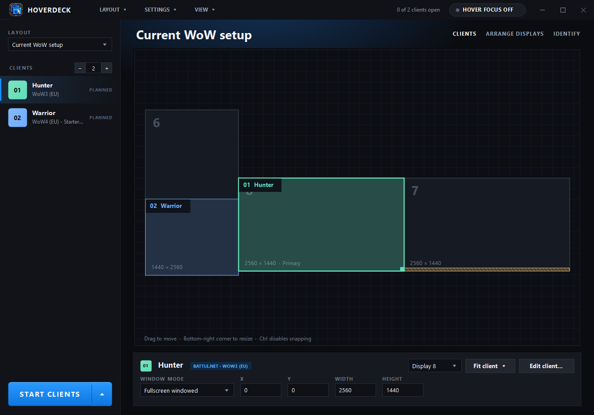

<p align="center">
  
</p>

<h1 align="center">HoverDeck</h1>

<p align="center">
  A Windows workspace for playing several World of Warcraft clients at once.<br>
  Lay out your game windows across your monitors, launch them in one click, and move between them just by pointing.
</p>

<p align="center">
  <a href="https://github.com/petterssonwm/HoverDeck/releases/latest"><b>Download the latest version</b></a>
</p>



## What it's for

If you run more than one WoW client at a time (multiboxing, or just keeping an alt open), you spend a lot of time opening clients, picking accounts, dragging windows into place and clicking to switch between them. HoverDeck does that setup for you and remembers it.

## What it does

- **Layouts on a map of your real monitors.** Draw where each client should go by dragging rectangles on a live map of your displays, or type exact positions. Snap to screen edges and halves, and choose *Windowed* (leaves room for the taskbar) or *Fullscreen windowed* per client. Save several layouts and switch between them.
- **One-click launching.** *Start clients* opens every client that isn't running yet and puts all of them in their places. Clients that are already open are reused, not duplicated.
  - **Battle.net:** picks the right installed WoW version and WoW account in your signed-in Battle.net launcher and presses Play for each client.
  - **Direct / private servers:** starts the game executable directly and can optionally fill in the login screen for you (credentials are encrypted with your Windows account).
- **Hover focus.** Point at a game window and it gets keyboard focus, without clicking and without bringing it to the front. Toggle it with a button or a global shortcut (Ctrl+Alt+H by default). Your original Windows settings are restored when HoverDeck closes, even after a crash.
- **Layers for overlapping clients.** Put a small window (say, a healer) on top of a full-screen main: give it a higher *Layer* and it always stays in front, even when you click or hover-focus the big window behind it. Other apps are never pushed behind your game.
- **Apply positions.** Moved a client on the map? An *Apply positions* button appears and moves the open windows into place without launching anything.
- **Edit or delete any client** from its right-click menu or the client editor.
- **Close or restart all clients** from the arrow on *Start clients*.
- **Arrange your Windows displays** (monitor positions and primary display) from inside HoverDeck, with a 20-second "keep or revert" safety net.
- **Minimize your way.** Minimize to the notification area (default) or to the taskbar like any other window.
- **Automatic updates.** The installed version checks for new releases and asks before updating.

HoverDeck only places windows, manages focus and starts clients. It does not broadcast keystrokes to multiple clients or automate gameplay. It is a fan-made tool, not affiliated with or endorsed by Blizzard Entertainment. Make sure your use follows the rules of the game or server you play on.

## Install

1. Download **HoverDeck-Setup.exe** from the [latest release](https://github.com/petterssonwm/HoverDeck/releases/latest) and run it.
2. Windows may show *"Windows protected your PC"* because the installer isn't code-signed yet. Click **More info**, then **Run anyway**.

It installs for your Windows account only (no administrator rights needed), adds desktop and Start menu shortcuts, and installs the .NET 8 Desktop Runtime and Microsoft WebView2 if they're missing. Uninstall it from **Settings → Apps → Installed apps** or **Programs and Features**. Your layouts and settings are kept in `%LOCALAPPDATA%\HoverDeck\Data`.

Prefer not to install? **HoverDeck-Portable.zip** on the same page runs from any writable folder, but doesn't update itself.

**Requirements:** Windows 10 or 11 (64-bit). For Battle.net clients, keep the desktop Battle.net launcher open, signed in and in English.

The full user guide is in [Read me.txt](Read%20me.txt).

## Built with AI

HoverDeck is AI-coded. Its code was written by AI coding assistants (OpenAI Codex and Anthropic's Claude Code), directed, reviewed and tested by me. The app icon was generated with ChatGPT. Every release is run through the project's automated checks (see [Verification.txt](Verification.txt)), but as with any hobby project, use it at your own risk and please [open an issue](https://github.com/petterssonwm/HoverDeck/issues) if something breaks.

## Building from source

Requires the .NET 8 SDK on Windows.

```powershell
dotnet build Source\HoverDeck.csproj -c Release
```

The app includes its own checks, for example `HoverDeck.exe --self-test report.txt` (regression checks) and `HoverDeck.exe --library-ui-check out-folder` (UI rendering and window checks).

To publish a new version (maintainer), install the Velopack tool once (`dotnet tool install -g vpk`), log in with `gh auth login`, then run:

```powershell
cd Source
.\release.ps1 -Version 1.7.2 -Notes "What changed"
```

This builds the app, packs the installer and update packages, and publishes a GitHub release. Installed copies offer the update on their next start.

## Privacy

Everything stays on your PC. Saved logins for private servers are encrypted with Windows DPAPI for your Windows account. Battle.net account lists are read from Blizzard's account website through a sign-in window you complete yourself; HoverDeck never reads your Battle.net password. Apart from that sign-in window and account-list refreshes you start yourself, the only network requests HoverDeck makes are update checks against this GitHub repository.
